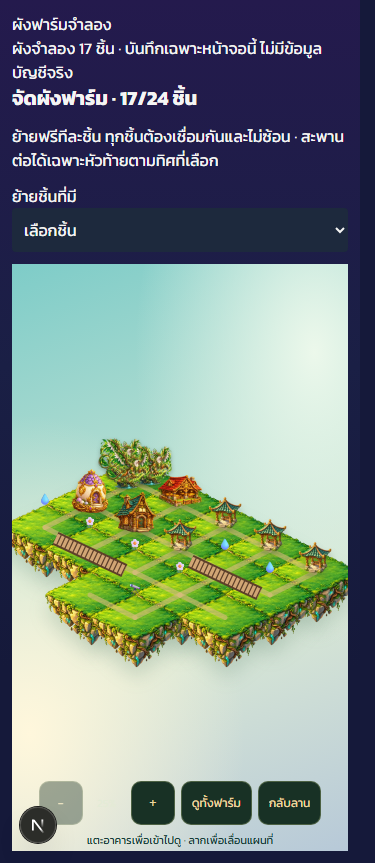
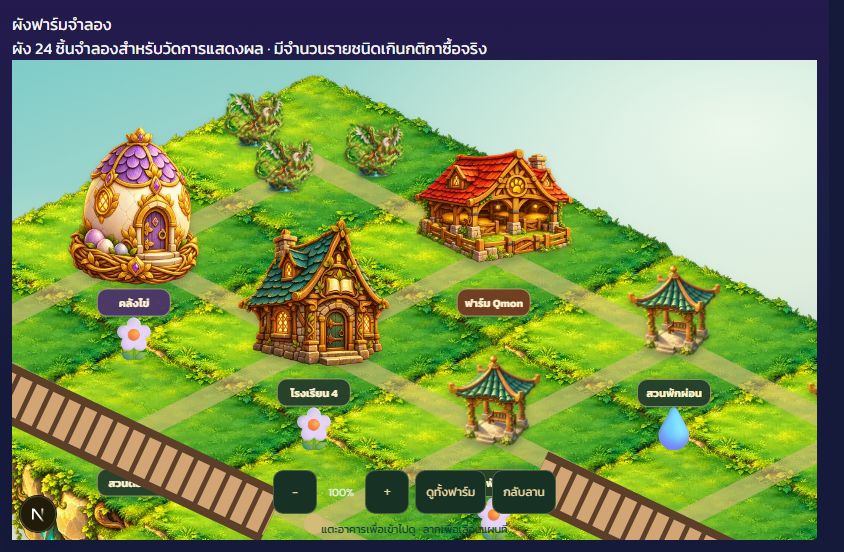

# Qmon Farm phase 4 — layout and bridge connectors (2026-10-12)

The unified layout reads the original school/garden coordinates, three starter base plots and placed generic projects. A school upgrade remains on its original plot; moving the school updates the legacy anchor and every placed upgrade together. Base positions are additive defaults, with no account backfill. The original dirty checkout remains untouched.

Owners can move one plot at a time for free, preview a new position, rotate bridges and confirm placement. No storage, demolition or selling is added. Server validation rejects overlap, disconnected layouts, wrong bridge axes, invalid coordinates, foreign IDs, missing starter plots, per-kind limits and more than 24 plots. Purchases already reserve both type and area capacity for unfinished projects. Owner advisory locks serialize moves and legacy/generic commands. A failed validation rolls back without modifying coins, job status, deadlines or puzzle layouts.

Bridges have opposite east–west or north–south ports and an actual two-cell-wide walking corridor. Side entry is blocked. A bridge needs a reachable end; an empty opposite end supports future expansion. Placing a plot at that end connects it across the corridor. It cannot connect through perpendicular neighbors, and rotating/moving a bridge cannot leave any plot unreachable. Residents recompute routes after a layout update and fall back to safe walkable cells when their previous position disappears.

Existing school/garden command bodies are retained in the new migration; only their placement validation reads the unified layout. Existing migrations are not rerun. Queue and layout navigation stay hidden when their additive schema/RPC is not installed. All catalogue rows remain disabled. Temporary symbolic pond/flower/observatory rendering is used while the later artwork phase is pending and must be replaced before production publication.

Synthetic verification:

- 101 isolated PGlite SQL checks passed, including previous sessions and schools 2–4 plus failed-move rollback, shared school position, unchanged ledger/balance, bridge axis and owner/role restrictions.
- PostgreSQL CI adds a two-connection race where two different base plots target one free position; exactly one must succeed. This remains pending until the PR CI run.
- 4 layout/route tests and 7 previous world tests passed: opposite bridge ports, real corridor traversal, blocked side exit, invalid movement, preserved input, and camera size invariant under translating the whole layout.
- 3 layout server authentication/payload tests passed.
- 59 browser checks passed with 3 synthetic Qmon at 320×568, 375×667, 390×844 and 844×390. Both 17-plot catalogue and 24-plot stress maps support pan, zoom, overview and return to meadow. Moving a base plot and rejecting a perpendicular bridge placement were checked.
- The 24-plot stress fixture intentionally exceeds current per-kind purchase limits; it is a rendering fixture, not an accepted player layout.
- Latest four-control batch timings were 242–360 ms in the local development browser. This includes automation overhead and is not a physical-phone FPS/production latency result. Full mobile measurements remain part of release verification/trial.
- Local lint passed; final TypeScript/CI results are recorded in the PR and Notion plan.

[Recorded measurement environment and timings](qmon-farm-layout-performance-2026-10-12.json)

No real account gameplay or progress write was performed, and the new migration has not been applied to production. Continue with phase 5 only after this phase's PR CI is green. Production publication needs a separate approval and the real two-week trial happens after publication.
